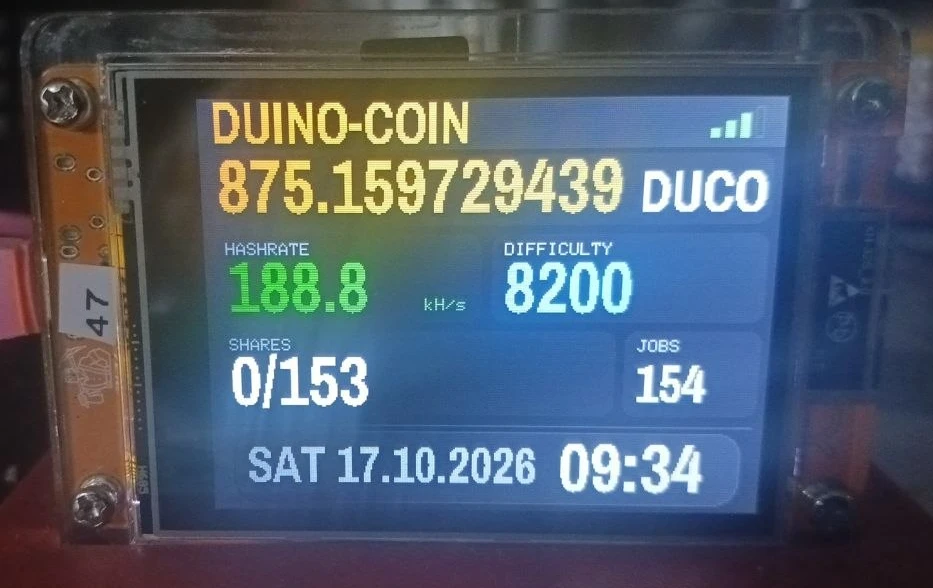
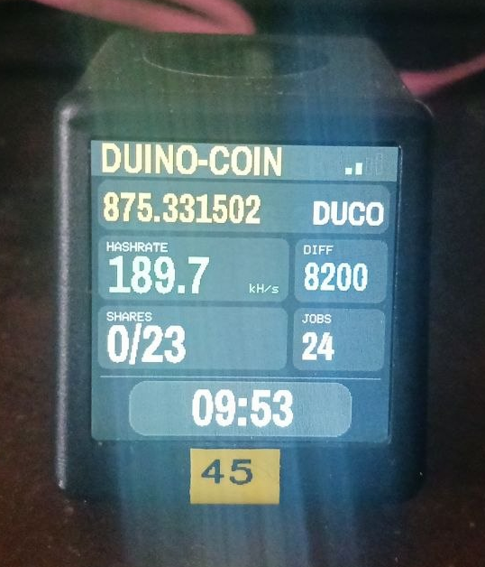
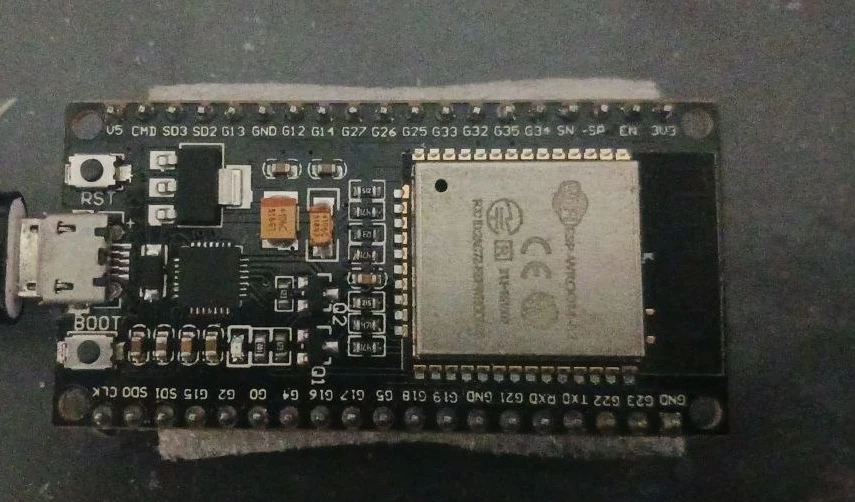
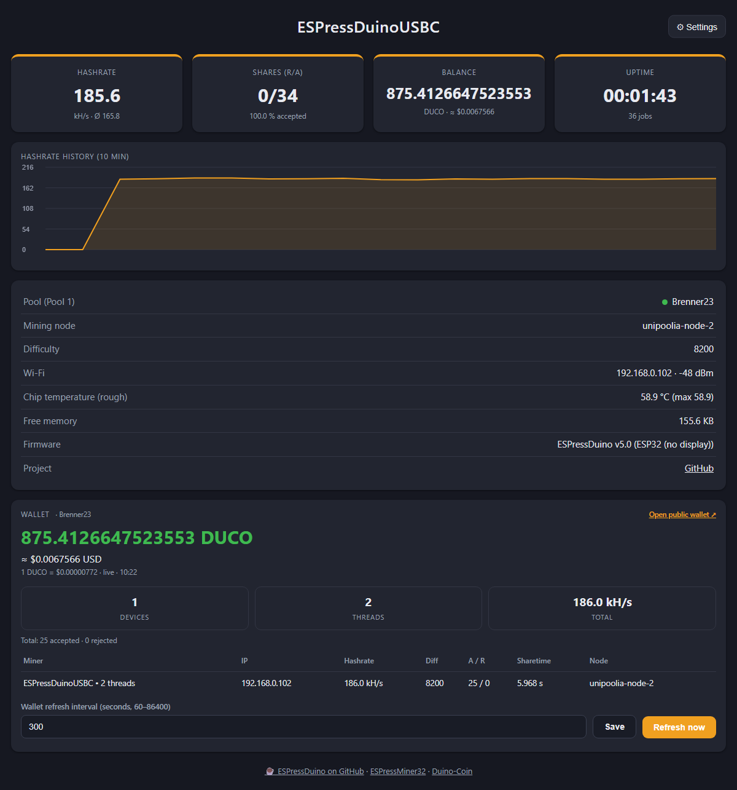
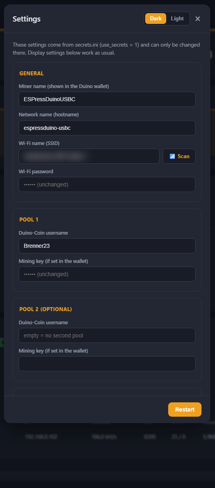

# ☕ ESPressDuino

🇬🇧 **English** · 🇩🇪 [Deutsch](README.de.md)

A **Duino-Coin miner for ESP32 display boards**, with the web dashboard and the setup portal of
[ESPressMiner32](https://github.com/brenner23/ESPressMiner32): Wi-Fi setup from your phone, two pools
(Duino-Coin accounts), hashrate history and your wallet at a glance. No credentials in the source code.

🔗 **Project page:** https://github.com/brenner23/ESPressDuino

> ⚠️ **Hobby project.** Duino-Coin is a fun coin for small devices. This is about learning and tinkering.

  

**Web dashboard** (left) and **settings** (right):

 

## Supported boards

| Board | Display | Status |
|---|---|---|
| **CYD** ESP32-2432S028 (2 USB ports) | ST7789 320×240, touch, light sensor | ✅ version 5.0, tested (~190 kH/s, 2 cores) |
| **NM-TV-154** (NerdMiner TV) | ST7789 240×240, touch pad | ✅ version 5.0, tested (~190 kH/s, 2 cores) |
| **ESP32 without display** (DevKit, USB-C / Micro-USB) | – (blue LED: on = mining, blinking = setup portal) | ✅ version 5.0, tested (~190 kH/s, 2 cores), also on chip **revision 1.0** |
| **MiniTV ESP32-C2** | ST7789 240×240, single core, 120 MHz | ✅ version 5.0, tested (~48 kH/s – the old firmware reached ~40) |

## Features

- Mining on **both ESP32 cores** (~90–100 kH/s per core on a CYD)
  Own measurement on the same CYD: the unmodified official miner reached only about **160 kH/s** – ESPressDuino about **190 kH/s** (+~19 %).
  > **Note on hashrate:** the ~190 kH/s on a CYD are measured with **no dashboard open**. An open dashboard
  > (any browser tab) polls the miner every 5 s; this runs on core 0, which also mines, and costs roughly 1–2 %.
  > The page is built to be cheap (the wallet table is only sent when it changes), but it is not free.
- **Setup portal:** Wi-Fi `ESPressDuino-XXXX`, Wi-Fi scan, everything stored on the device (NVS)
- **Pool 1 / Pool 2:** each with Duino-Coin **username + mining key**; switch by button or automatically every N minutes
- **Web dashboard** at `http://espressduino.local/`: hashrate history (10 min), shares, balance, uptime
- **Wallet view** like the official wallet page: balance, USD value, devices/threads/total hashrate and one row per
  device (all cores of a device are grouped, e.g. `CYD47-Test • 2 threads`), link to the public wallet page
- **Display settings** in the browser: brightness (live preview), auto light (light sensor), rotation 0/90/180/270°
- **BOOT button 5 s** (NM-TV: touch pad 10 s; MiniTV C2: none – portal on Wi-Fi loss/first start) → setup portal opens (settings are kept, mining continues)
- **Wi-Fi watchdog:** reconnects automatically, restarts after 5 min without Wi-Fi
- Optional: everything from `secrets.ini` instead of the portal (see below)
- Only **free fonts** (Archivo Narrow Bold, SIL OFL 1.1), licence files in `include/Fonts/`

## 🐞 The white screen bug – the display was innocent

The base of this project (the official Duino-Coin ESP32 miner, modified for the CYD) kept turning the screen
**white** or showed garbage after a while. Everybody blamed the display, the SPI bus or the TFT library.
**It was none of them** – and finding that out took a long, fiddly search.

The official miner blinks the "built-in LED" on every share and defines it as **`LED_BUILTIN 2` (GPIO 2)** for
the ESP32. On the CYD (and on the NM-TV-154) **GPIO 2 is `TFT_DC`** – the Data/Command line of the display.
(On the CYD you would expect the status LED to be the RGB LED on the back – but the code switched GPIO 2.)
Every share toggled that line, often right in the middle of a display transfer. The display received pixel data
as commands and vice versa → white screen.

**Fix (FIX03):** all LED functions of the original code are disabled (`FIX03_001 LED DISABLED` in the source).
GPIO 2 now belongs to the display only. Since then: no more white screens.

Two more bugs from the original code were fixed on the way:

- **FIX14 – SHA-1 warm-up read out of bounds:** `DSHA1::warmup()` hashed 20 bytes from a string literal that is
  only 15 bytes long (incl. NUL), i.e. it read 5 bytes past the end of the object. Now a fixed 20-byte buffer.
- **V11 – watchdog timer shared between cores:** `max_micros_elapsed()` used a `static` local timestamp, so core 0
  and core 1 shared one timer and took each other's watchdog yield away. Now every mining job has its own timer.

If you build your own Duino-Coin firmware for a display board: **check which pin `LED_BUILTIN` is on.**

## First-time setup

As long as nothing is stored, the miner does **not** mine but opens the setup portal:

1. Connect to the Wi-Fi **`ESPressDuino-XXXX`** (password `espressduino`). The page opens automatically,
   otherwise go to `http://192.168.4.1/`.
2. Enter a miner name, your Wi-Fi (🔍 Scan), and your **Duino-Coin username** and **mining key** (Pool 1).
   Pool 2 is optional.
3. **Save & restart.** The miner connects and starts mining. Dashboard: `http://<hostname>.local/`.

The portal also opens if the stored Wi-Fi cannot be reached for 30 s (the miner keeps trying in the background),
and when you **hold the BOOT button for 5 s** (the display counts down).

### Alternative: `secrets.ini` instead of the portal

Copy `secrets.example.ini` to `secrets.ini`, fill it in and set **`use_secrets = 1`**. The firmware then takes
Wi-Fi, accounts, miner name and hostname from there and starts without the portal. In the browser the settings are
read-only in this mode (display and wallet settings still work). `secrets.ini` is in `.gitignore` and never goes
into the repository. Without `secrets.ini` (or with `use_secrets = 0`) the portal is used.

`secrets.ini` also holds the **OTA password** and the IP address for the `*_ota` environments (optional).

## Build & flash (VS Code + PlatformIO)

1. Open the folder in VS Code with PlatformIO.
2. Choose the environment (`cyd_usb`, `nmtv_usb`, `esp32_usb` or `c2_usb`) and click **→ Upload**.
3. Serial monitor: 500000 baud.

### Updates over Wi-Fi (OTA)

Every board has an `*_ota` environment (`cyd_ota`, `nmtv_ota`, `esp32_ota`, `c2_ota`). Put the **IP address of your
device** (shown in the dashboard under Wi-Fi and on the serial console at boot) and an optional OTA password into
`secrets.ini` (`ota_ip_cyd`, `ota_ip_nmtv`, `ota_ip_esp32`, `ota_ip_c2`, `ota_pass`), then upload with that environment.
The default address `192.168.0.100` is only a placeholder – **change it**.

There are intentionally no prebuilt firmware files: you flash what you can read in the source.

## Project layout

```
ESPressDuino/
├── platformio.ini          Environments, optional secrets.ini
├── secrets.example.ini     Template (OTA, optional credentials)
├── include/
│   ├── EdSettings.h        Settings (NVS) + Pool 1/2
│   ├── EdWebPage.h         Dashboard + setup page
│   ├── MiningJob.h         Duino-Coin mining (DUCO-S1)
│   ├── NMDisplay.h         Display, wallet
│   ├── Settings.h          Build switches, version
│   └── Fonts/              Free fonts (OFL) + licences
└── src/                    main.cpp, EdSettings.cpp
```

## Credits & licence

Based on the official [Duino-Coin](https://github.com/revoxhere/duino-coin) ESP32 miner (MIT).
Web dashboard and setup portal adapted from [ESPressMiner32](https://github.com/brenner23/ESPressMiner32).
Fonts: Archivo Narrow Bold (SIL OFL 1.1). Developed with the assistance of Claude.

MIT – see [LICENSE](LICENSE).
